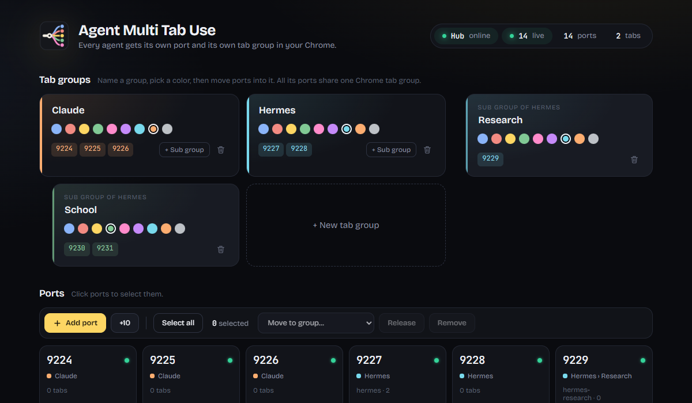

# Agent Multi Tab Use

[](https://github.com/poponline63/agent-multi-tab-use/releases/latest)
[](https://github.com/poponline63/agent-multi-tab-use/releases)
[](LICENSE)


Let every AI agent on your PC work in **your real Chrome** at the same time. Each agent gets its own port and its own tab group, and they never fight over tabs or steal your screen.



Works with anything that speaks the Chrome DevTools Protocol: Claude Code, Codex, Hermes, custom agents, **Puppeteer**, **Playwright**, **Browser Use**, and raw CDP.

## Why

Browser automation normally means launching a separate, logged-out Chrome, or pointing every agent at the same debug port where they trip over each other. Agent Multi Tab Use gives each agent its own lane into the browser you're already signed into:

- **One port per agent.** An agent claims a port and gets a CDP URL (`http://127.0.0.1:9236`).
- **One tab group per agent.** Its tabs land in a named, colored Chrome tab group ("Hermes", "Claude", ...), with optional sub groups ("Hermes › Research").
- **Agents can't see each other's tabs.** Tabs are owned by the port that opened them.
- **Private by default.** Agents only see tabs they opened, never your email or bank. You can switch sharing on.
- **Never steals focus.** Agent tabs open in the background and can't be brought to the front.
- **Agents self-serve.** They claim ports, create groups, and add ports through a small local API. Anything that reduces your control (sharing your tabs, pulling ports from another agent's group) needs your confirmation first.

## How it works

```
agent  ──connects to──▶  companion app (127.0.0.1)  ◀──connects to──  Chrome extension ──▶ your tabs
```

Chrome extensions can't accept incoming connections, so a small companion app listens on the ports and passes messages to the extension (over one connection, whatever the number of ports), which drives your tabs with `chrome.debugger`.

## Install (Windows)

1. Download `AgentMultiTabUse.exe` and `agent-multi-tab-use-extension.zip` from [Releases](https://github.com/poponline63/agent-multi-tab-use/releases/latest).
2. Run `AgentMultiTabUse.exe`. It has no window: it lives in the system tray (hover for status, right-click for the status page, log, restart and quit), starts with Windows, and restarts itself if it ever crashes. (Windows may say "Windows protected your PC". Click **More info**, then **Run anyway**. The app isn't code-signed yet.)
3. Unzip the extension, open `chrome://extensions`, turn on **Developer mode**, click **Load unpacked**, and pick the unzipped folder.
4. Click the extension icon. The dashboard should show **Hub online**.

To stop the app: **Quit** in the tray menu, or `AgentMultiTabUse.exe --quit`.

## If something doesn't work

- **Tray says "Waiting for Chrome"**: open Chrome and check the extension is enabled in `chrome://extensions`. It connects within a few seconds.
- **`GET /status` shows a `warning` about versions**: update the older half, then click reload on the extension.
- **An agent gets an error**: the message says why (Chrome's own reason for a tab it can't debug, or that Chrome isn't connected). Agents ride out short gaps on their own: commands wait up to 10 seconds while the extension or app reconnects, and agents keep their tabs across restarts.
- **Anything else**: right-click the tray icon, **Open log** (`%LOCALAPPDATA%\Agent Multi Tab Use\hub.log`).

Ports are one shared pool: a released port goes to the next agent, and spare ones are removed again, so the list doesn't keep growing. An agent that forgets to release is released after 60 idle minutes, and its leftover tabs are tidied the same way (tabs you've looked at stay open). Popups and links an agent's page opens join that agent's tab group.

## Give an agent access

Open the dashboard, go to **Agent setup**, pick a group, and click **Copy for agent**. Paste that into your agent. It explains everything below with ready-to-run snippets.

### MCP server (easiest)

Any MCP agent (Codex, OpenCode, Claude Code, Hermes, oh-my-pi, ...) can use `mcp/server.mjs` instead of writing CDP code. Node 22+, no dependencies. It claims a port on first use, keeps the agent's tabs in its own group, and releases the port when the agent exits.

Tools: `browser_open`, `browser_read` (page text + numbered elements), `browser_click`, `browser_type`, `browser_screenshot`, `browser_eval`, `browser_tabs`, `browser_close`, `browser_claim`, `browser_release`.

```json
{ "command": "node", "args": ["<repo>/mcp/server.mjs"], "env": { "AMTU_AGENT": "codex", "AMTU_GROUP": "Codex" } }
```

`AMTU_AGENT` names the agent (the process id is added, so two sessions never share a port), `AMTU_GROUP` is its Chrome tab group. Check it against your live Chrome with `node mcp/selfcheck.mjs`.

### Raw API

```bash
# 1. claim a port (same agent name = same port back)
curl -s -X POST http://127.0.0.1:9223/claim -H "Content-Type: application/json" -d '{"agent":"my-agent","group":"My Agent"}'
# -> {"port":9236,"cdpUrl":"http://127.0.0.1:9236","group":"My Agent","ready":true}
```

```js
// 2. drive it with Puppeteer
const browser = await puppeteer.connect({ browserURL: "http://127.0.0.1:9236", defaultViewport: null });
const page = await browser.newPage();
await page.goto("https://example.com");
```

```python
# or Playwright
browser = p.chromium.connect_over_cdp("http://127.0.0.1:9236")
page = browser.contexts[0].new_page()
page.goto("https://example.com")
```

```bash
# 3. release when done
curl -s -X POST http://127.0.0.1:9223/release -H "Content-Type: application/json" -d '{"agent":"my-agent","all":true}'
```

### API (`GET http://127.0.0.1:9223/` lists it all)

| Endpoint | What it does |
|---|---|
| `GET /status` | Every port, its group, who holds it, live or not, plus settings and version info |
| `POST /claim` | Get your own port. `group` names your Chrome tab group (default "Agents"); `count` for several, `parent` for a sub group |
| `POST /release` | Give ports back (`all` for every port you hold). Tabs you opened close unless the user looked at them; `keepTabs` / `closeTabs` override |
| `POST /group` | Set a tab group's color |
| `POST /group/delete` | Forget a group's color |
| `POST /ports` | Add ports (up to 250) |
| `POST /adopt` | Take over a tab the user opened (only while sharing is on) |
| `POST /settings` | `shareTabs` (turning it on needs **user confirmation**) |

Each port also serves the standard DevTools endpoints: `GET /json/version`, `GET /json/list`, `PUT /json/new?<url>`, and `WS /cdp`.

## Security

- Everything listens on **127.0.0.1 only**. Nothing is reachable from your network or the internet, and nothing is sent online.
- **Web pages can't use it.** Requests carrying a website's `Origin` are refused.
- Requests must be addressed to `127.0.0.1` or `localhost` by name, which blocks DNS-rebinding tricks.
- One browser connection at a time: while your Chrome is connected, another extension or profile can't take its place.
- Agents can't close your browser, grant site permissions, or switch your active tab.
- **Any program on your PC can reach the ports while the app runs**, the same as Chrome's own `--remote-debugging-port`. Quit the app when you don't want agents in your browser.
- Chrome shows a "started debugging this browser" bar on tabs agents control. That's expected.

## Build from source

Requires [Bun](https://bun.sh) and Windows (the tray icon is compiled with the `csc.exe` that ships with Windows).

```bash
cd companion
bun selftest.js      # hub self-test, runs on its own test ports
bun run build        # -> companion/dist/AgentMultiTabUse.exe
```

The extension in `extension/` loads unpacked as is.

## Credits

- The CDP relay in `companion/relay/` is adapted from the browser relay in [oh-my-pi](https://www.npmjs.com/package/@oh-my-pi/pi-coding-agent) by Mario Zechner and Can Bölük (MIT). See `companion/relay/LICENSE` and `NOTICE`.
- Fonts: Bricolage Grotesque and JetBrains Mono, SIL Open Font License (see `extension/fonts/`).

## License

MIT. See [LICENSE](LICENSE).
